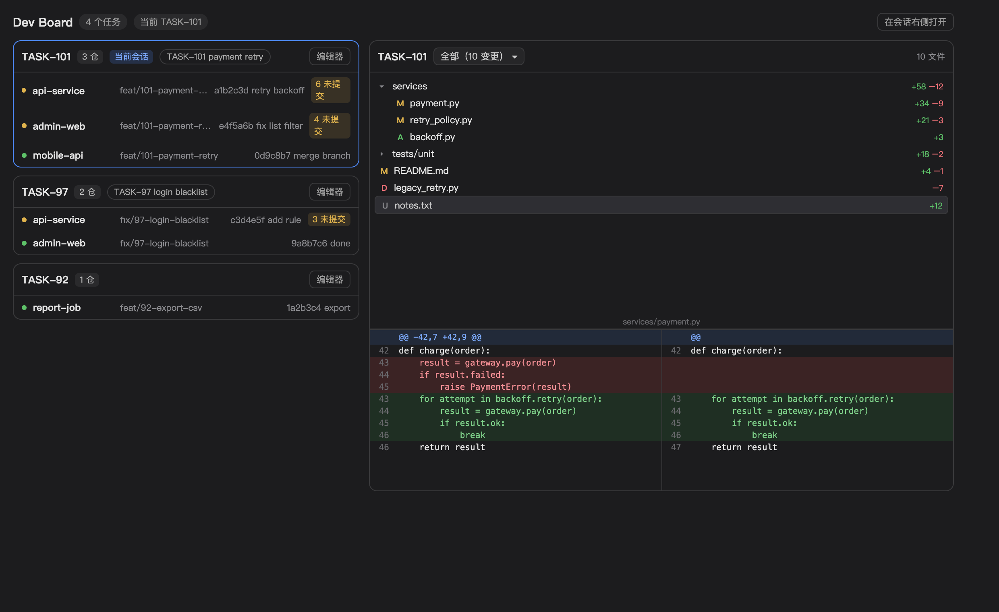

# Hermes Dev Board

A cross-repo worktree board for the [Hermes Agent](https://hermes-agent.nousresearch.com) desktop app.
It groups git worktrees by **task id** — one feature spanning several repositories shows up as one card
with every repo, branch, last commit and pending-change count — and links the board to your **chat
sessions**, so the panel beside your conversation always shows the worktrees, changed-file tree and
side-by-side diffs of the task you are currently talking about.



## What you get

- **Board page** (sidebar → *Dev Board*): every task across all worktree roots, one card per task,
  repo rows with branch / last commit / dirty count, session chips that jump to the related chat.
- **Chat-side dock panel**: opens right next to the conversation. It follows the **focused session** —
  switch sessions and the panel switches to that session's task. Shows:
  - all changed files of the task across repos, with a repo filter dropdown (All / per-repo);
  - a collapsible **directory tree** with per-file `+added / −removed` counts (compact single-child
    chains, VS Code style);
  - a **side-by-side file diff** (old / new columns, own line numbers, add/del/mod row alignment);
  - one-click **open in editor**: every worktree of the task in one multi-root window
    (VS Code by default, configurable).
- 15 s auto-refresh; untracked files get a synthesized `new file` diff.

## Install

Requires the Hermes desktop app with plugin support.

1. **Backend (dashboard plugin API)** — copy to the Hermes home the gateway scans:

   ```bash
   mkdir -p ~/.hermes/plugins/dev-board
   cp -r dashboard ~/.hermes/plugins/dev-board/
   ```

   Then add `dev-board` to the `plugins.enabled` list of the config the gateway runs under
   (for a `--profile default` gateway that is `~/.hermes/config.yaml`):

   ```yaml
   plugins:
     enabled:
       - dev-board
   ```

2. **Frontend (desktop plugin)** — copy to the app-level plugin root:

   ```bash
   mkdir -p ~/.hermes/desktop-plugins/dev-board
   cp desktop/plugin.js ~/.hermes/desktop-plugins/dev-board/
   ```

3. Restart the Hermes desktop app. *Dev Board* appears in the sidebar and ⌘K;
   "Dev Board: worktree panel beside chat" docks the companion panel to the right of the chat.

## Configuration (environment variables on the gateway process)

| Variable | Default | Meaning |
|---|---|---|
| `DEV_BOARD_WORKTREE_ROOTS` | `~/.worktrees:~/code/.worktrees:~/code/.tmp-worktrees` | Colon-separated worktree roots to scan |
| `DEV_BOARD_TASK_RE` | `-(\d{2,6})$` | Regex for the task-id suffix of a worktree dir (`repo-1234` → task `1234`) |
| `DEV_BOARD_TITLE_RE` | `([A-Za-z]+-\d{2,6})` | Regex extracting a task id from a session title (`ZT-9248 …`, `GH-12 …`) |
| `DEV_BOARD_SESSION_DBS` | `$HERMES_HOME/state.db` + `profiles/*/state.db` | Colon-separated session stores to map sessions → tasks |
| `DEV_BOARD_EDITOR` | `Visual Studio Code` (macOS) / `code` | Editor for the multi-root open |

Any ticket prefix works — ZT, GH, JIRA, plain numbers — as long as the title regex matches it.
Nothing is ZT-specific; the prefix shown in the UI is taken from the matched session label.

## How it maps tasks

- A **worktree** belongs to task *N* when its directory name matches `DEV_BOARD_TASK_RE`
  (default: ends in `-1234`).
- A **session** belongs to task *N* when its title matches `DEV_BOARD_TITLE_RE`
  (default: contains `PREFIX-1234`). The numeric part joins both sides.

## Security notes

- `changes`/`diff` reject any `dir` outside the configured worktree roots and any `file` with `..`.
- The backend is read-only except `open_editor`, which only spawns the configured editor with
  paths under the worktree roots.
- Session stores are opened SQLite read-only (`mode=ro`).

## Uninstall

```bash
rm -rf ~/.hermes/plugins/dev-board ~/.hermes/desktop-plugins/dev-board
# and remove dev-board from plugins.enabled
```

## License

MIT
